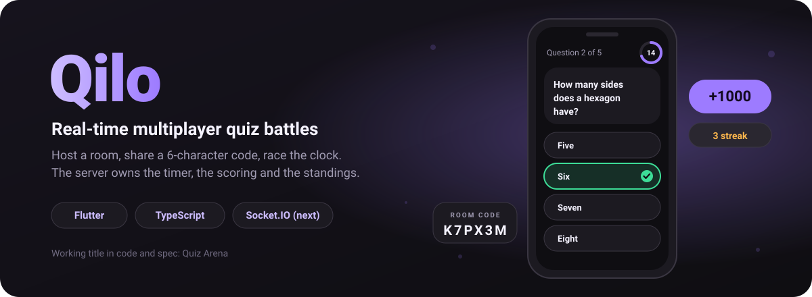

<p align="center">
  
</p>

<p align="center">
  
  
  
  
  
</p>

# Qilo

**Qilo is a live, competitive quiz platform.** A host opens a room from a quiz and shares a 6-character code. Players join from their phones and answer against a timer that the server controls. The server checks each answer, scores it and publishes live standings, then shows the final results.

It is built for the moment a group wants to compete on knowledge *right now*: two friends on a sofa, a classroom on a projector, or a 500-person community event.

> **Name note:** the code and the product spec still use the working title **Quiz Arena** (package `quiz_arena`, `@quiz-arena/api`). Qilo is the repository name.

---

## Why Qilo

| Principle | What it means in practice |
|---|---|
| ⚡ **Start in seconds** | A player joins with a code and a name. No install wall and no account needed. |
| ⚖️ **Fair by construction** | The server owns timing, answer acceptance, scoring and ranking. Clients only display state and send intents. |
| 👀 **Clear at every moment** | Players always know the phase, the time left, their status and what comes next. |
| 📶 **Forgiving networks** | A brief disconnect never costs a player their seat, and offline players never hold a question open. |

---

## Repository layout

```text
qilo/
├── apps/
│   ├── api/                      # TypeScript game engine (server-authoritative)
│   │   ├── package.json
│   │   └── src/
│   │       ├── game/
│   │       │   ├── scoring.ts    # classic-v1
│   │       │   ├── standings.ts  # tie-breaks + ranking
│   │       │   ├── lifecycle.ts  # state machine
│   │       │   ├── answer.ts     # acceptance + early reveal
│   │       │   └── game.test.ts  # 31 tests
│   │       └── room/
│   │           └── room-code.ts
│   └── mobile/                   # Flutter client
│       ├── lib/
│       │   ├── design/           # tokens, theme, widgets
│       │   ├── game/             # controller, models, scoring mirror
│       │   ├── screens/          # 6 screens
│       │   └── main.dart
│       └── test/
├── docs/
│   ├── assets/                   # README illustrations (SVG)
│   ├── ui-reference/             # visual reference
│   └── Quiz_Arena_Complete_Product_and_Technical_Documentation_v1.1.docx
├── LICENSE
└── README.md
```

---

## Getting started

### Prerequisites

- **Node.js 24+** for the engine. It runs TypeScript directly, with no build step and no dependencies.
- **Flutter 3.x** (Dart SDK `^3.13.7`) for the mobile app.

### Run the engine tests

```bash
cd apps/api
npm test            # node --test src/**/*.test.ts
```

On Node 22, you can run the same tests with `node --experimental-strip-types --test src/**/*.test.ts`.

### Run the mobile app

```bash
cd apps/mobile
flutter pub get
flutter test        # 13 tests
flutter run         # pick a device or emulator
```

> **Tip:** when you set up the Flutter SDK for the first time, run Flutter from a folder that is *not* this project's root. The tool runs `pub upgrade` in the current directory.

---

## License

[MIT](LICENSE) © 2026 Arpan Roy
