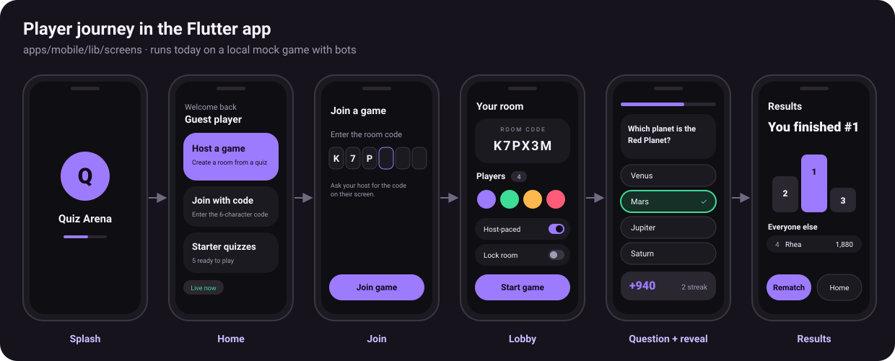
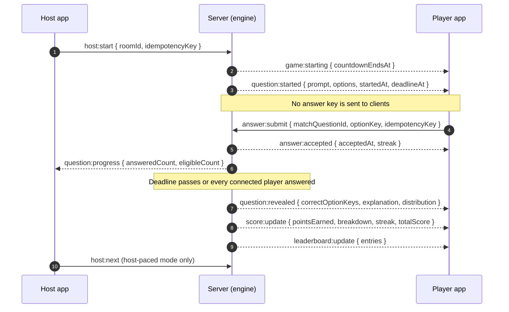
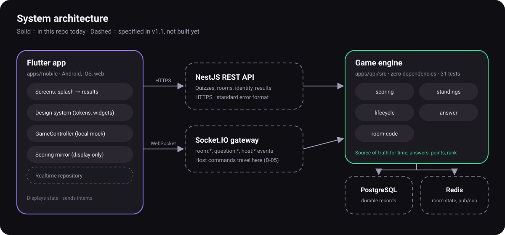
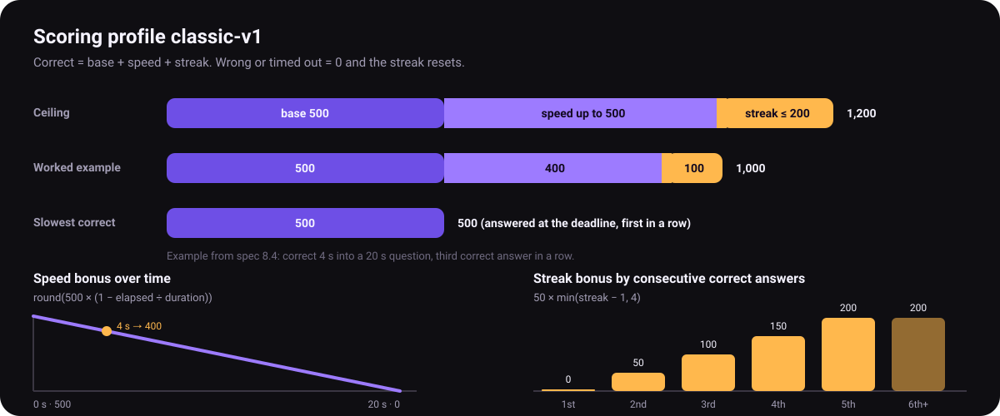
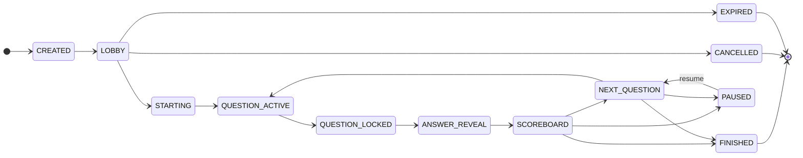
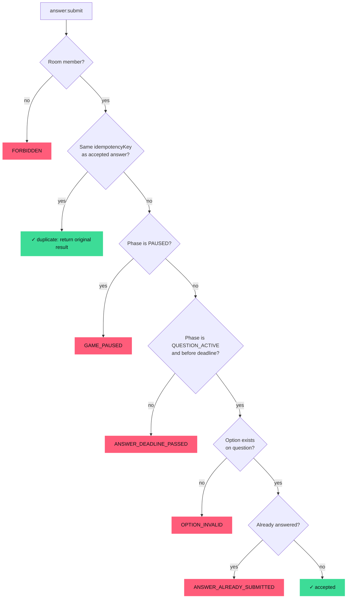

<p align="center">
  
</p>

<p align="center">
  
  
  
  
  
</p>

# Qilo

**Qilo is a live, competitive quiz platform.** A host opens a room from a quiz and shares a 6-character code. Players join from their phones and answer against a timer that the server controls. The server checks each answer, scores it and publishes live standings, then shows the final results.

It is built for the moment a group wants to compete on knowledge *right now*: two friends on a sofa, a classroom on a projector, or a 500-person community event.

> **Name note:** the code and the product spec still use the working title **Quiz Arena** (package `quiz_arena`, `@quiz-arena/api`). Qilo is the repository name.

---

## Why Qilo

| Principle | What it means in practice |
|---|---|
| ⚡ **Start in seconds** | A player joins with a code and a name. No install wall and no account needed. |
| ⚖️ **Fair by construction** | The server owns timing, answer acceptance, scoring and ranking. Clients only display state and send intents. |
| 👀 **Clear at every moment** | Players always know the phase, the time left, their status and what comes next. |
| 📶 **Forgiving networks** | A brief disconnect never costs a player their seat, and offline players never hold a question open. |

---

## How a match works

<p align="center">
  
</p>

<sub>These are illustrations of the screens in <code>apps/mobile/lib/screens</code>, not device screenshots.</sub>

1. **Host** creates a room and gets a code like `K7PX3M`.
2. **Players** enter the code, appear in the lobby, and the host starts the game once at least 2 players are in.
3. Each **question** runs on a server deadline (20 s by default). The first answer a player submits is final.
4. The question **locks** at the deadline, or earlier if every connected player has answered. Then the correct answer, an explanation and the answer distribution are **revealed**.
5. A **scoreboard** shows the standings. The game moves on automatically, or waits for the host in *host-paced* mode.
6. After the last question, the **results** screen shows a podium and offers a rematch.

The planned realtime protocol for one question looks like this (event names from spec §12):



---

## Architecture

<p align="center">
  
</p>

The project follows a **server-authoritative** model. The Flutter client keeps a copy of the scoring rules **for display and tests only**. The server is always the source of truth (spec §7.1).

The plan is to share contracts, not code. The Dart and TypeScript sides each implement the same rules, and both are checked against the same worked examples from the spec. Later, versioned schemas will be shared from `packages/api-contracts`.

---

## The game engine

`apps/api/src` holds a TypeScript engine with **no runtime dependencies**. Each rule lives in a small, pure function, so it is easy to test exhaustively before any transport is added.

| Module | File | Responsibility |
|---|---|---|
| Scoring | [`game/scoring.ts`](apps/api/src/game/scoring.ts) | `classic-v1` points: base, speed bonus, streak bonus |
| Standings | [`game/standings.ts`](apps/api/src/game/standings.ts) | Tie-break comparator and competition ranking |
| Lifecycle | [`game/lifecycle.ts`](apps/api/src/game/lifecycle.ts) | Room and match state machine with guarded transitions |
| Answer | [`game/answer.ts`](apps/api/src/game/answer.ts) | Answer acceptance, idempotency and early reveal |
| Room codes | [`room/room-code.ts`](apps/api/src/room/room-code.ts) | Secure 6-character codes with collision retry |

### Scoring: classic-v1

<p align="center">
  
</p>

```text
correct     → 500 base
            + round(500 × (1 − elapsed ÷ duration))      speed bonus, 0 to 500
            + 50 × min(streak − 1, 4)                    streak bonus, 0 to 200
wrong/late  → 0 points, streak resets to 0
```

**Worked example (spec §8.4):** a player answers correctly 4 s into a 20 s question, and it is their third correct answer in a row. That gives `500 + 400 + 100 = 1,000` points. This exact case is a test on both the server and the client.

```ts
import { scoreAnswer } from "./game/scoring.ts";

scoreAnswer({
  correct: true,
  streakBefore: 2,
  startedAtMs: 0,
  receivedAtMs: 4_000,
  durationMs: 20_000,
});
// → { base: 500, speed: 400, streak: 100, total: 1000, streakAfter: 3 }
```

Every match stores its scoring-profile version, so old scores can always be explained.

### Standings and tie-breaks

Players are sorted by these keys, in order:

| # | Key | Direction |
|---|---|---|
| 1 | Total score | higher first |
| 2 | Correct answers | more first |
| 3 | Total answer time | faster first |
| 4 | Longest streak | longer first |

If players are still tied after all four keys, they **share the rank** and the next rank skips (`1, 1, 3`). The order in which answers arrived at the server is **never** used to break a tie.

### Match lifecycle

The server owns every transition. Clients only send commands. An invalid move throws `InvalidTransitionError`.



> **Not drawn, to keep the diagram readable:** the host can move the match to `ENDED_EARLY` from any in-match phase (`STARTING` through `PAUSED`). Pausing is allowed only *between* questions, and resuming always goes to the next question.

### Answer acceptance

Checks run in the order the spec gives (§12.2), so the same submission always gets the same error code:



- An answer received **exactly at** the deadline is accepted. One millisecond later, it is rejected.
- **Early reveal** (D-09) fires when every *currently connected* player has answered. Disconnected players never hold a question open.

### Room codes

- 6 characters from `ABCDEFGHJKLMNPQRSTUVWXYZ23456789`, which leaves out the easily confused **O/0** and **I/1**.
- Drawn from `node:crypto`'s `randomInt`, a cryptographically secure source.
- `allocateRoomCode` retries when a code collides with an active room. It throws instead of silently creating a duplicate when the code space is exhausted.

---

## Repository layout

```text
qilo/
├── apps/
│   ├── api/                      # TypeScript game engine (server-authoritative)
│   │   ├── package.json
│   │   └── src/
│   │       ├── game/
│   │       │   ├── scoring.ts    # classic-v1
│   │       │   ├── standings.ts  # tie-breaks + ranking
│   │       │   ├── lifecycle.ts  # state machine
│   │       │   ├── answer.ts     # acceptance + early reveal
│   │       │   └── game.test.ts  # 31 tests
│   │       └── room/
│   │           └── room-code.ts
│   └── mobile/                   # Flutter client
│       ├── lib/
│       │   ├── design/           # tokens, theme, widgets
│       │   ├── game/             # controller, models, scoring mirror
│       │   ├── screens/          # 6 screens
│       │   └── main.dart
│       └── test/
├── docs/
│   ├── assets/                   # README illustrations (SVG)
│   ├── ui-reference/             # visual reference
│   └── Quiz_Arena_Complete_Product_and_Technical_Documentation_v1.1.docx
├── LICENSE
└── README.md
```

---

## Getting started

### Prerequisites

- **Node.js 24+** for the engine. It runs TypeScript directly, with no build step and no dependencies.
- **Flutter 3.x** (Dart SDK `^3.13.7`) for the mobile app.

### Run the engine tests

```bash
cd apps/api
npm test            # node --test src/**/*.test.ts
```

On Node 22, you can run the same tests with `node --experimental-strip-types --test src/**/*.test.ts`.

### Run the mobile app

```bash
cd apps/mobile
flutter pub get
flutter test        # 13 tests
flutter run         # pick a device or emulator
```

> **Tip:** when you set up the Flutter SDK for the first time, run Flutter from a folder that is *not* this project's root. The tool runs `pub upgrade` in the current directory.

---

## License

[MIT](LICENSE) © 2026 Arpan Roy
